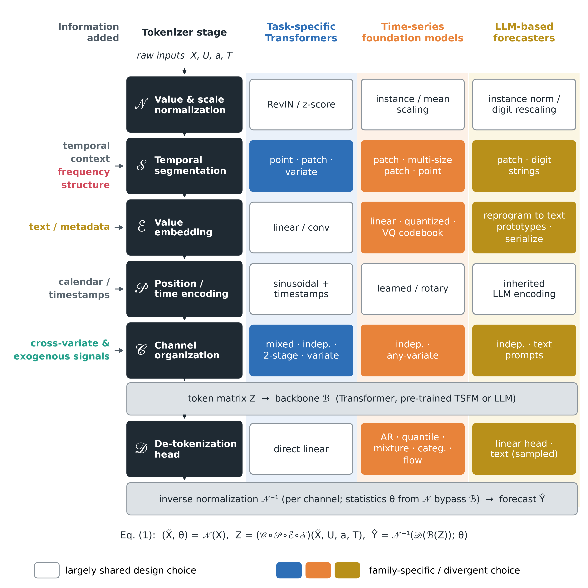
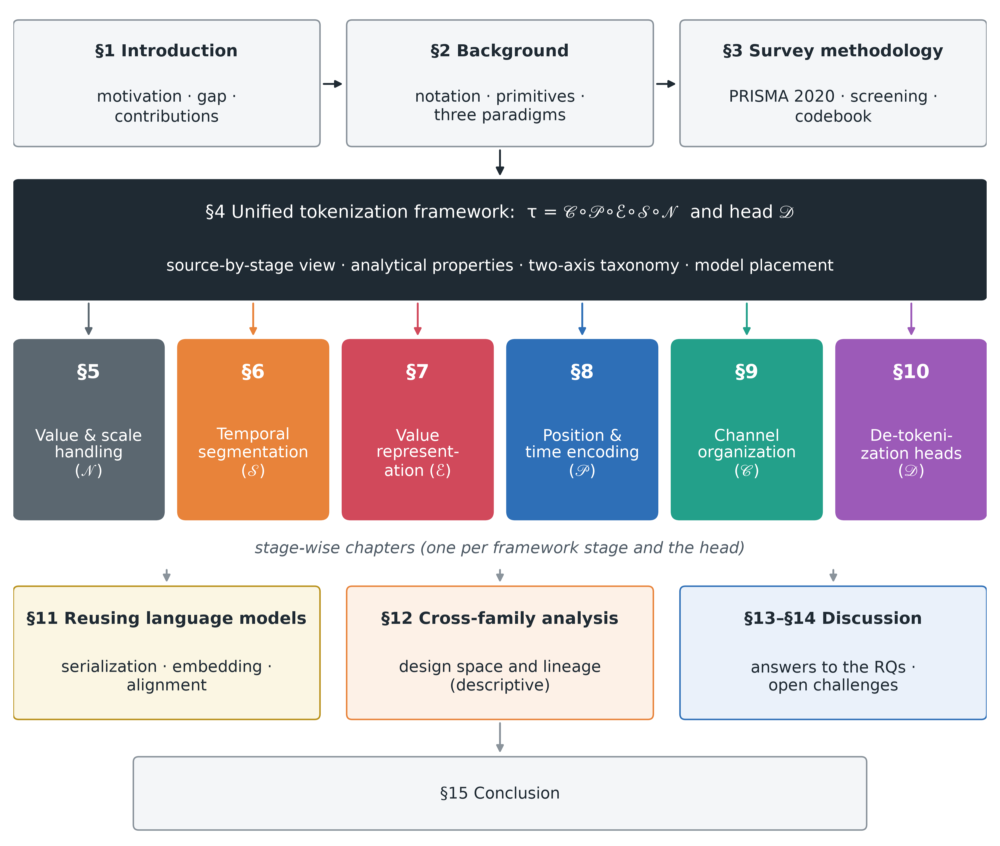
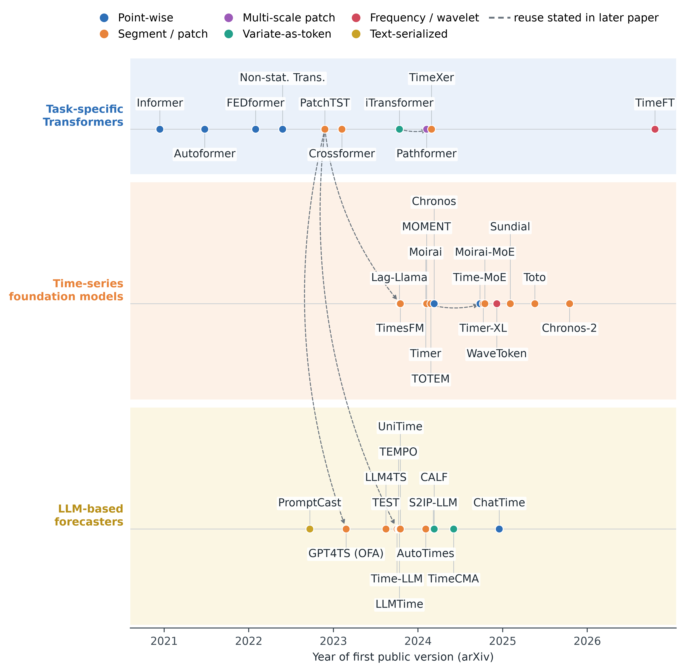
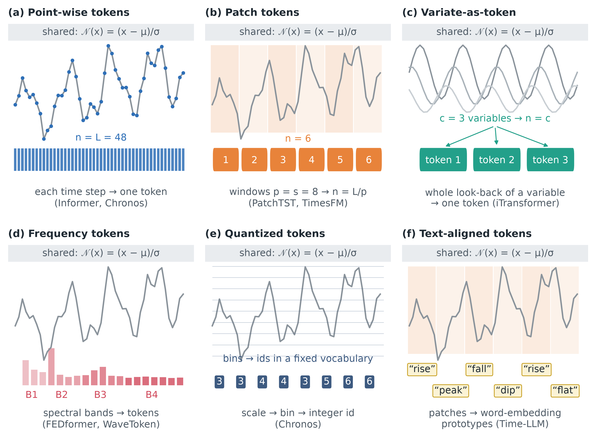

# Tokenization as the Unifying Design Axis of Time-Series Forecasters

Supplementary records and figures for the survey "Tokenization as the Unifying Design Axis of Time-Series Forecasters: A Survey from Transformers to Foundation Models and Large Language Models", submitted to *Neurocomputing*.

The survey argues that tokenization (how a raw series is normalized, segmented into units, mapped to token values, organized across channels, and decoded back by the forecasting head) is the design axis that connects Transformer forecasters, time-series foundation models, and forecasters that reuse large language models. Following PRISMA 2020, we screened 4,215 unique records, included 390 studies, and coded 37 representative forecasters along the stages of a unified tokenization framework.

*Fig. 1. Unified view of time-series tokenization: the five stages and the information each stage brings in.*

*Fig. 2. Roadmap of the survey.*

*Fig. 3. Timeline of representative forecasters by paradigm and token granularity.*

*Fig. 7. Six tokenization schemes applied to the same toy series.*

## Contents

- `Supplementary_Material_S1_Screening.xlsx`: screening records, search strategy, coding table, and methods appendix. The workbook contains the following sheets:
  - `README`: overview of the workbook, search date, eligibility criteria, and column definitions.
  - `Methods appendix`: codebook notes, keyword rules, the full search strategy narrative (PRISMA item 7), the dataset-to-domain dictionary, and a list of the released records.
  - `Table S1 arXiv queries`: arXiv query strings (abstract field) and hit counts.
  - `Table S2 Codebook`: codebook used for data extraction.
  - `Table S3 Exclusions`: exclusion reasons by screening stage.
  - `Search strategy`: full search strategy for every source (PRISMA 2020 item 7), including query strings, proceedings sources, OpenAlex requests, month of retrieval, and counts.
  - `Deduplication`: title-normalization rule and the mapping of every removed duplicate to the record that was kept.
  - `PRISMA counts`: counts shown in the PRISMA 2020 flow diagram (Fig. 4) and in Table S3, computed from the Screening log sheet.
  - `Screening log`: one row per unique record after de-duplication (n = 4,215), with the decision and reason at every stage.
  - `Full-text assessment`: all reports sought for full-text retrieval (n = 428), with the source of the full text and the reason for each decision.
  - `Included studies`: the 390 included studies, with first public year, manuscript citation fields, and coding family for the 37 coded models.
  - `Facet terms`: regular expressions used for Table 5 and Fig. 16(b), with the matches and first public year of every included study.
  - `Second screening`: design of the second screening, agreement statistics, changed decisions, and the adjudication log.
  - `Coding table (37 models)`: machine-readable coding of the 37 representative forecasters, with an evidence location for each coded value.
  - `Lineage evidence`: page and statement in the later paper for each dashed arrow of manuscript Fig. 3.
  - `Coding verification log`: second-pass verification of the coding of the 37 representative forecasters (Table 4, Fig. 8).
- `figures/`: the four figures shown above (`fig1_framework.png`, `fig2_roadmap.png`, `fig3_timeline.png`, and `fig7_tokenization_schemes.png`).
